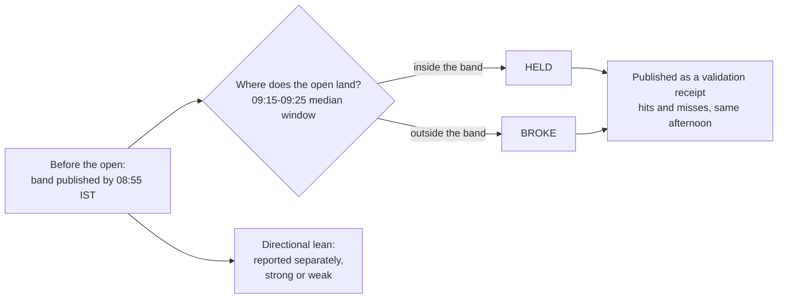

# How to read a band

This is a conceptual guide to interpreting a Veritas output. It describes what the
fields mean — not how they are produced.

## The band

Veritas publishes a **range** for the opening window: a lower band and an upper band.
The band edges are the boundaries of the expected opening range. They are reference
points for where the range of expected outcomes runs out — not targets, and not
levels to act on.

Most sessions, the open lands somewhere inside the band. When the open lands outside,
the band is recorded as a miss on the public validation receipt.

## The midpoint

The midpoint is the centre of the range. It is a central reference, not a prediction
of a single price and not a target.

## The directional lean

Alongside the band, Veritas may report a directional lean with a confidence figure.
This is a lean, never a call to act. The lean and the range are judged separately.

## Range confidence

Range confidence describes how concentrated the expected range is for that session.
When confidence is low, the model says so. On low-confidence days the band is the
primary read; the directional lean carries little weight. A wide band with honest
confidence is more useful than a narrow band that hides uncertainty.

## The lifecycle of a band

## In short

- Read the **band** as the boundaries of the expected opening range.
- Read the **midpoint** as the centre, not a target.
- Read the **directional lean** as a separate, honestly-graded read.
- When confidence is **low**, lean on the range.

For the public record of how bands have held up, see
[`validation.md`](validation.md).
