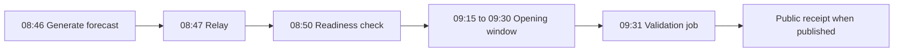

# How to read a Veritas band

This is a guide to **field interpretation**, not an API schema or disclosure of the private forecasting algorithm. A Veritas band concerns opening-window uncertainty for NIFTY 50, BANK NIFTY or SENSEX.

## Lower and upper bounds

These are bounds of a pre-open probability interval. They are **not** entry prices, exit targets, stop-losses or a recommendation. The calibration design targets **80% coverage**; that target is not proof that four out of five recent bands actually held.

## Centre versus arithmetic midpoint

The arithmetic midpoint is the average of the lower and upper bounds. The separately reported **model centre** need not equal that arithmetic midpoint. The centre interpretation was revised in October 2026, so consult the dated output and method version.

## Direction and confidence

Direction and range are evaluated independently. A weak or neutral directional assessment communicates uncertainty, not a buy/sell instruction. A range-confidence field and directional-confidence or reliability field need not have the same definition. Neither implies guaranteed market performance.

## Operational lifecycle (nominal IST times)

Scheduled timing is **not a service-level guarantee** and does not establish that a receipt exists for every date. The observed validation rule changed around **13 - 14 October 2026**; compare historical outcomes within their correct method cohorts.

The **8 November 2026 audit** found **104 linked receipts** and a gap of **56 calendar dates between 24 July and 17 September inclusive**, including non-trading days.

## Reading the current rolling results - 14 November 2026

The [model page](https://aionanalytics.in/models/veritas) displays up to the last 30 completed trading sessions, loaded from public receipts. A **reference-price hit** is based on a recorded reference price inside the forecast band, not proof that the complete opening-window high and low were contained. Where full-window range data are absent, the rolling table correctly says **Not measured** for full-range containment.

Directional, NEUTRAL and minute-test results use separate denominators. Missing and unverified outcomes are not automatic misses. The [13 November historical correction](https://aionanalytics.in/veritas/historical.html#correction) preserves earlier figures alongside corrected eligibility counts.

## Access and limitations

- Published terms provide a **seven-calendar-day NIFTY-only trial**, with verified email and passkey, no card.
- BANK NIFTY, SENSEX or access after trial require eligible paid entitlement.
- Existing historical receipts can be read publicly; a missing date is neither an automatic hit nor an automatic miss.
- In the **8 November audit**, new historical API rows were not accumulating pending an archival-only repair. The uploaded 14 November model page does not verify a later fix; the public receipt archive is separate.
- The latest audit did not retest authenticated API access, signup or checkout.

Read the [validation guide](validation.md), [product access page](https://aionanalytics.in/veritas) and [public receipt archive](https://aionanalytics.in/veritas/validation).
